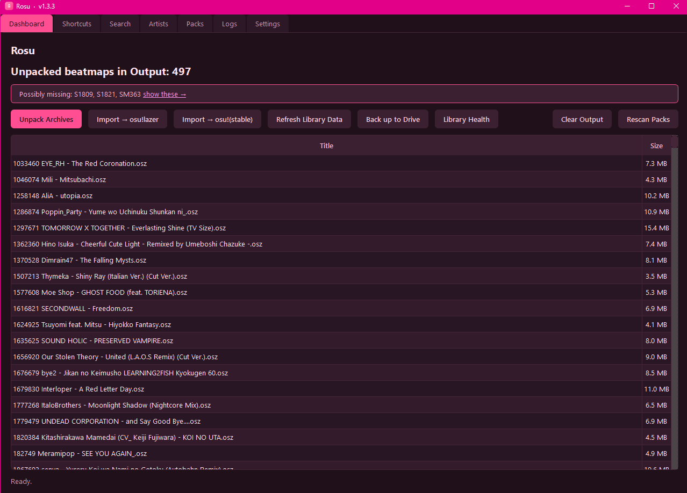
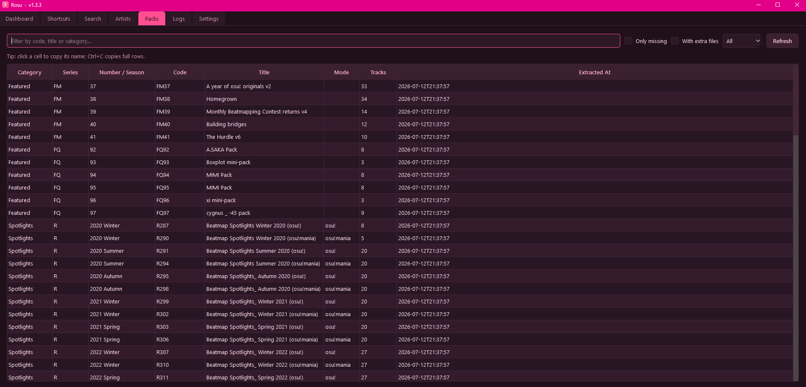
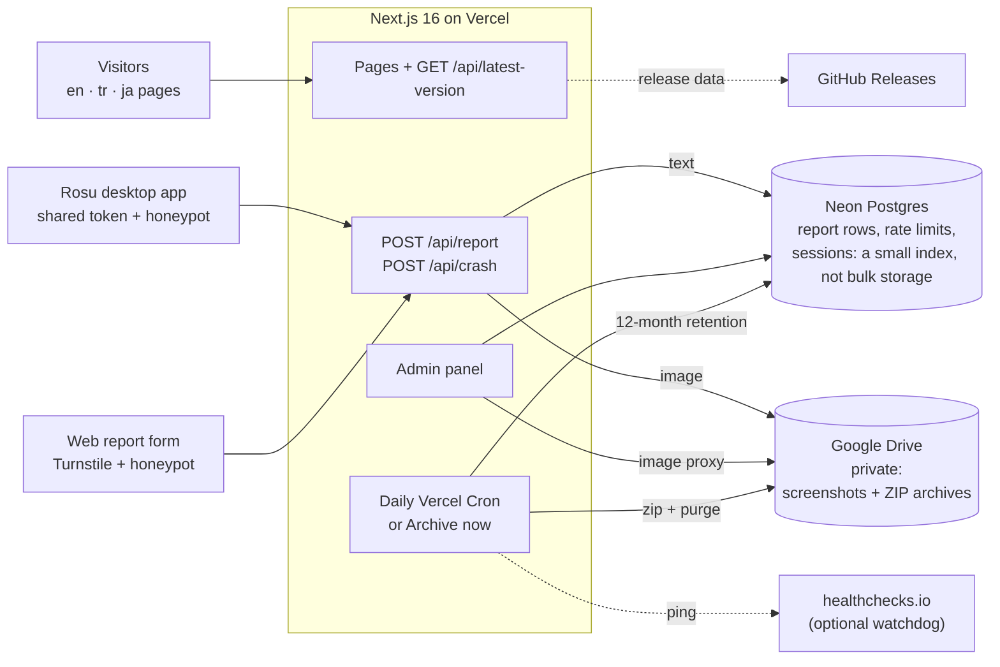

<a name="readme-top"></a>

<div align="center">


**The website, docs and bug-report backend for [Rosu](https://github.com/Kerevizodunu2000/rosu)**, the free, open-source osu! beatmap-pack manager for Windows<br/>
that unpacks and archives packs, backs up to Google Drive, imports to osu!, finds missing packs and updates itself with signed releases.

### [rosu-web.vercel.app](https://rosu-web.vercel.app)

[](./LICENSE)
[](https://nextjs.org)
[](https://react.dev)
[](./tsconfig.json)
[](https://rosu-web.vercel.app/ja)
[](https://vercel.com)

[Open the site](https://rosu-web.vercel.app) · [Read the guide](https://rosu-web.vercel.app/docs) · [Report a problem](https://rosu-web.vercel.app/report) · [Privacy](https://rosu-web.vercel.app/privacy)

</div>

> [!NOTE]
> Rosu and rosu-web are an **unofficial, fan-made project, not affiliated with or endorsed by ppy Pty Ltd or osu!**. They are free, open-source and non-commercial: no sales, no donations, only free tiers.

## What's on the site

rosu-web started as a landing page plus a bug-report system. It is now also the docs, changelog, devlog, status page and a set of in-browser tools, in three languages. Everything runs on **free, no-credit-card, never-sleeping** infrastructure.

<table>
<tr>
<td width="33%" valign="top">

**🏠 Landing page**<br/>
What Rosu does, screenshots in an accessible lightbox, a Download button and schema.org JSON-LD.

</td>
<td width="33%" valign="top">

**📖 Docs**<br/>
The user guide, plus the public API contract the desktop app uses.

</td>
<td width="33%" valign="top">

**📝 Changelog & devlog**<br/>
Every desktop release from GitHub Releases (rebuilt hourly), and development notes.

</td>
</tr>
<tr>
<td valign="top">

**🐞 Bug reports**<br/>
A web form and `POST /api/report`, which the desktop app posts to directly. Turnstile, honeypot and rate limits.

</td>
<td valign="top">

**🔗 Status tracking**<br/>
Each report gets a private link: received → in review → fixed in vX. No account.

</td>
<td valign="top">

**🩺 Status page**<br/>
Live health of the site, report intake and the update check.

</td>
</tr>
<tr>
<td valign="top">

**🧩 Missing-pack checker**<br/>
Drop your pack files and see which S / SM / ST / SC packs you don't have yet.

</td>
<td valign="top">

**🖼️ Share card & Rosu Wrapped**<br/>
Turn a Rosu library export into a shareable image, or your year in beatmaps.

</td>
<td valign="top">

**🌐 English, Türkçe, 日本語**<br/>
A language switcher, `hreflang` on every page and a trilingual sitemap.

</td>
</tr>
<tr>
<td valign="top">

**🔐 Admin panel**<br/>
Password + TOTP, server-side sessions, an optional secret path and an audit log.

</td>
<td valign="top">

**🗄️ Nightly archive**<br/>
Reports and screenshots are zipped into Google Drive, and 12-month retention is enforced.

</td>
<td valign="top">

**♿ Accessible**<br/>
axe checks in the e2e suite, reduced motion respected, 24×24 px tap targets.

</td>
</tr>
</table>

> [!TIP]
> The tools run **entirely in your browser** and upload nothing. Only file names (missing packs) or the export you pick (share card, Wrapped) are read, on your computer.

<div align="center">
<table>
<tr>
<td align="center"></td>
<td align="center"></td>
</tr>
<tr>
<td align="center"><sub>The desktop app's Dashboard, shown on the landing page</sub></td>
<td align="center"><sub>The Packs tab, where missing-pack detection lives</sub></td>
</tr>
</table>
</div>

## How it works



- **Report text** goes to **Neon** (serverless Postgres). It is used for rate limiting, atomic ids, the admin listing and staged/archived status, *not* as bulk storage.
- **Screenshots** go to a private **Google Drive**, reusing the desktop app's existing OAuth client (scope `drive.file`).
- A **daily Vercel Cron** (plus a manual "Archive now" button) bundles pending reports and images into a ZIP in Drive and empties the staging area, so no small-quota store ever fills. The same nightly job **enforces the 12-month retention** (old archive ZIPs, archived report rows, crash data and the admin log are deleted) and pings an optional **healthchecks.io** watchdog. Reports are also archived right away once `AUTO_ARCHIVE_THRESHOLD` are pending.
- Every report gets a private **tracking link** (`/report/status/<token>`; only the token's hash is stored) showing received → in review → fixed in vX. Reporters can opt in to a one-off confirmation e-mail with that link (Resend).
- The app migrates its own database schema on first use (idempotent DDL in `db/schema.mjs`), so a deploy can never run against missing columns.
- The public endpoint is defended by a **honeypot**, **Cloudflare Turnstile** (web form), a **shared token** (desktop app) and **per-IP + global rate limits**. IPs are only ever stored as a salted hash.

## Pages & API

English lives at the bare paths, Turkish under `/tr` and Japanese under `/ja` (for example `/tr/docs`, `/ja/tools/wrapped`). Release notes, devlog posts and the API reference stay in English inside the translated pages and say so. The desktop app itself is in English and Turkish.

| Route | What | Languages |
|---|---|---|
| `/` | Landing page (screenshots open in an accessible lightbox; schema.org JSON-LD) | en · tr · ja |
| `/docs` | User guide | en · tr · ja |
| `/docs/api` | The public API contract the desktop app uses | en · tr · ja (reference in English) |
| `/changelog` | Every desktop release from GitHub Releases (rebuilt hourly) | en · tr · ja (notes in English) |
| `/devlog`, `/devlog/<slug>` | Development notes (Markdown posts in `content/devlog/posts.ts`) | en · tr · ja (posts in English) |
| `/status` | Live health of the site, report intake and update check | en · tr · ja |
| `/tools` | The in-browser tools. All of them run in the browser and upload nothing | en · tr · ja |
| `/tools/missing-packs` | Which numbered S / SM / ST / SC packs you are missing, from the pack file names | en · tr · ja |
| `/tools/share-card` | A shareable image from a Rosu library export: sets, hours of music, top artists, modes | en · tr · ja |
| `/tools/wrapped` | Rosu Wrapped: your year in beatmaps, with a 1080×1350 PNG to share | en · tr · ja |
| `/report` | Report / contact form (Turnstile-protected) | en · tr · ja |
| `/report/status/<token>` | A reporter's private status page (no account) | en · tr · ja |
| `/privacy` | Privacy Policy. The binding text is EN + TR; `/ja` adds a Japanese summary | en · tr · ja (summary) |
| `/terms` | Terms. The binding text is EN + TR; `/ja` adds a Japanese summary | en · tr · ja (summary) |
| `/admin` | Submissions with search, filters and pages, single and bulk status updates, one-click "delete everywhere" for data requests, statistics, crash groups, activity log (password + optional TOTP; can live under a secret `ADMIN_PATH`) | en |

| API | What |
|---|---|
| `POST /api/report` | Accepts the desktop app **and** the web form; returns `{ ok, id, status_url }` |
| `POST /api/crash` | Opt-in crash fingerprints from the desktop app (token + rate limit, scrubbed server-side) |
| `GET /api/health` | `{ ok, db }` for uptime monitors (503 when the database is down) |
| `GET /api/latest-version` | Latest desktop release (version, download + SHA-256 URLs, notes) for the in-app update check; CDN-cached |
| `GET /api/cron/archive` | Nightly job: archive → 12-month retention → watchdog ping (Vercel Cron) |
| `POST /api/admin/{login,logout,archive,status,delete}` | Admin session, manual archive, report status (one or up to 100 at once), delete a report everywhere (row + Drive screenshot + its archive entry) |
| `GET /api/admin/image/[id]` | Auth-gated Drive image proxy (never a public URL) |

## Tech stack

| Layer | Choice |
|---|---|
| Framework / host | **Next.js 16** (App Router), **React 19**, **Tailwind 4**, **TypeScript** (strict) on **Vercel** (Hobby) |
| Database | **Neon**: serverless Postgres, no card, auto-resume |
| Image / archive storage | **Google Drive** (`drive.file` scope, OAuth refresh token) |
| Web-form captcha | **Cloudflare Turnstile** |
| Admin session | signed cookie (`jose`) carrying a server-side session id (Neon): revocable, rotated, TOTP 2FA |
| Archives | in-memory ZIP (`jszip`) |
| Security headers | nonce-based CSP on the report and admin pages, HSTS, COOP/CORP, Trusted Types (report-only) |
| Tests | **Vitest** (unit, offline) · **Playwright + axe** (e2e and accessibility) |

## Details

<details>
<summary><b>Local development</b></summary>

```bash
npm ci
cp .env.example .env.local      # then fill in the values (see below)
npm run migrate                 # optional: create/upgrade the Neon tables up front (the app also does it on first use)
npm run dev                     # http://localhost:3000
npm run test                    # Vitest (unit)
npm run build && npm run e2e    # Playwright smoke + axe accessibility checks (needs a Chromium: npx playwright install chromium)
```

The landing, docs, privacy and terms pages work with **no env vars at all**. The report pipeline, admin panel and archive jobs need real services (Neon, a Google OAuth client + refresh token, Turnstile); the service layer in `lib/` takes injected dependencies, so the unit tests run offline.

Before a pull request, run what CI runs: `npx tsc --noEmit`, `npm run lint`, `npx vitest run` and `npm run build`. CI also runs `npm audit --omit=dev --audit-level=high` and the Playwright e2e suite.

</details>

<details>
<summary><b>Environment variables</b></summary>

Set these in Vercel (Project → Settings → Environment Variables) and, for local dev, in `.env.local` (git-ignored). Names only; see [`.env.example`](./.env.example).

| Variable | Purpose |
|---|---|
| `DATABASE_URL` | Neon Postgres connection string |
| `GOOGLE_OAUTH_CLIENT_ID` / `_SECRET` | Reused from the Rosu desktop OAuth client |
| `GOOGLE_REFRESH_TOKEN` | Minted once via `scripts/mint-drive-token.mjs` (sign in as the Rosu account) |
| `GOOGLE_DRIVE_ROOT_FOLDER` | Drive folder name (default `Rosu Reports`) |
| `NEXT_PUBLIC_TURNSTILE_SITE_KEY` / `TURNSTILE_SECRET_KEY` | Cloudflare Turnstile |
| `REPORT_APP_TOKEN` | Shared friction token for the desktop path |
| `ADMIN_PASSWORD` | `/admin` login |
| `ADMIN_SESSION_SECRET` | Signs the admin session cookie |
| `IP_HASH_SALT` | Salts hashed IPs |
| `CRON_SECRET` | Protects the archive cron route |
| `AUTO_ARCHIVE_THRESHOLD` | Archive right away once this many reports are pending (default 25, `0` = off) |
| `ADMIN_PATH` | *Optional.* Secret admin path (12–64 chars `A-Z a-z 0-9 _ -`); `/admin` then answers 404 |
| `ADMIN_TOTP_SECRET` | *Optional.* Requires an authenticator code at sign-in; generate with `node scripts/totp-setup.mjs` |
| `RESEND_API_KEY` / `ACK_EMAIL_FROM` | *Optional.* Enable the opt-in confirmation e-mail (both required) |
| `HEALTHCHECKS_PING_URL` | *Optional.* healthchecks.io ping for the nightly job (`/fail` on error) |
| `GITHUB_TOKEN` | *Optional.* Higher GitHub API limit for `/api/latest-version` |

</details>

<details>
<summary><b>Project structure</b></summary>

```
app/              App Router routes
  (site)/           English pages (landing, docs, changelog, devlog, status, tools, report, privacy, terms)
  (intl)/[lang]/    the same pages in Turkish (/tr) and Japanese (/ja)
  admin/            the admin panel (can hide behind ADMIN_PATH)
  api/              report, crash, health, latest-version, cron and admin endpoints
components/       Nav, Footer, Brand, LanguageSwitcher, ReportForm, Lightbox, MissingPacks, ShareCard, Wrapped, AdminTable, AdminPanels
  views/            page bodies shared by every language
content/
  i18n/             en.ts, tr.ts, ja.ts: every user-facing string
  devlog/           devlog posts
  docs.ts           the user guide
lib/              service layer: db, drive, validation, ratelimit, turnstile, session, zip, report/archive services,
                  i18n, packs, wrapped, shareCard, dsar, retention, crash, totp, csp, adminPath
proxy.ts          secret admin path, session rotation, per-request CSP nonce
next.config.ts    security headers
db/               schema.mjs (idempotent DDL, shared by the app and `npm run migrate`) + migrate script
scripts/          mint-drive-token.mjs (Drive refresh token) · totp-setup.mjs (admin 2FA secret)
test/             Vitest unit tests (offline, dependencies injected)
e2e/              Playwright smoke, i18n and axe accessibility tests
public/           brand mark, icon and the app screenshots
factory/          the software-factory scripts and checks (factory/checks.sh)
docs/             README art
reference/        the earlier (rejected) Google Apps Script approach, kept for context
```

</details>

<details>
<summary><b>Security</b></summary>

**Admin sign-in and sessions**

- Sign-in = password (constant-time) + optional TOTP code (each code works once). Failed attempts from one address trigger a progressive lockout (30 s, doubling, max 15 min) on top of the per-IP rate limit. Every sign-in and admin action lands in an audit log shown in the panel.
- Sessions live server-side: a `__Host-` cookie (`HttpOnly`, `Secure`, `SameSite=Strict`) carries only a random session id. Idle timeout 2 h, absolute 12 h, a fresh id every 15 min of use (each id rotates once); logout ends the whole sign-in and "sign out everywhere" revokes every session on the server.
- With `ADMIN_PATH` set, admin routes answer only through the proxy (which stamps a gate header); a malformed value disables the panel rather than exposing `/admin`.
- Limits and lockouts key on the IPv6 /64 (IPv4: the address).

**Headers**

- The report and admin pages get a strict per-request nonce CSP (`proxy.ts`, `lib/csp.ts`), with Trusted Types in report-only mode.
- Every page sends HSTS (two years, subdomains, no preload), `Cross-Origin-Opener-Policy: same-origin`, `X-Frame-Options: DENY`, `frame-ancestors 'none'`, `nosniff`, a strict referrer policy and a locked-down `Permissions-Policy`. API responses add `Cross-Origin-Resource-Policy: same-origin`, and status pages never send a `Referer`.

Security issues go through [SECURITY.md](./SECURITY.md), privately, never as a public issue.

</details>

<details>
<summary><b>Privacy</b></summary>

A submission contains only what the user types (title, description, optional contact e-mail), light diagnostics (app version, OS, UI language) and an optional screenshot the user attaches. No hidden telemetry. Raw IPs are never stored, only a salted hash used solely for rate limiting. What's sent is disclosed on the form.

- **Retention:** the nightly job deletes old archive ZIPs, archived report rows, crash data and the admin log after 12 months (`lib/retention.ts`).
- **Deletion requests (KVKK/GDPR):** one click in the admin panel deletes a report everywhere: the row, the Drive screenshot and its archive entry (`lib/dsar.ts`).
- **Tools:** the missing-pack checker, share card and Rosu Wrapped run in the browser and upload nothing.
- **Policy:** the full policy is at [`/privacy`](https://rosu-web.vercel.app/privacy). The binding text is English + Turkish; the Japanese page adds a summary.

</details>

> [!IMPORTANT]
> **Privacy in short:** raw IP addresses are never stored (only a salted hash, for rate limiting), there is no hidden telemetry, report data is deleted after 12 months, and any report can be deleted everywhere on request.

## Contributing

Contributions are welcome. See [CONTRIBUTING.md](./CONTRIBUTING.md) for setup and guidelines, and the [Code of Conduct](./CODE_OF_CONDUCT.md). Security issues go through [SECURITY.md](./SECURITY.md) (privately, never a public issue). Found a bug in the **desktop app**? Report it in the [rosu repository](https://github.com/Kerevizodunu2000/rosu/issues) or with the in-app "Report a problem" form.

## Community

- **Website**: <https://rosu-web.vercel.app>
- **Instagram**: <https://www.instagram.com/rosu.app/>
- **X**: <https://x.com/RosuApp>
- **YouTube**: <https://www.youtube.com/@RosuApp>
- **Reddit**: <https://www.reddit.com/user/RosuApp/>
- **E-mail**: rosu.app@gmail.com

## License

[GPL-3.0-or-later](./LICENSE), matching the Rosu desktop app.

---

<div align="center">


Rosu is **free, open-source and non-commercial. It takes no money (no sales, no donations)**.<br/>
It is an **unofficial, fan-made tool, not affiliated with or endorsed by ppy Pty Ltd or osu!**. Contact: **rosu.app@gmail.com**

[rosu-web.vercel.app](https://rosu-web.vercel.app) · [Rosu desktop app](https://github.com/Kerevizodunu2000/rosu) · [Back to top ↑](#readme-top)

</div>
